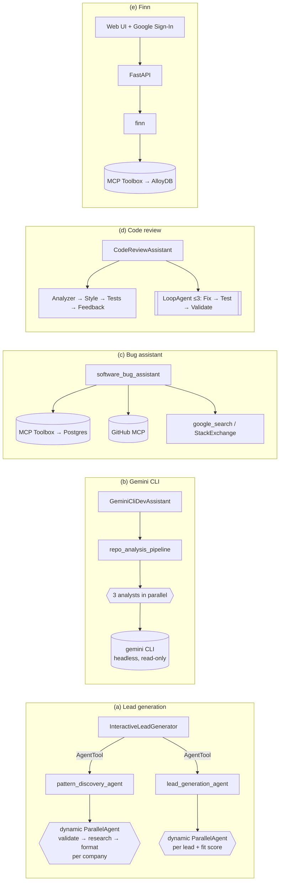

# Assignment 3 — End-to-end Google ADK agent applications

Five production-minded agents built with the **Google Agent Development Kit (ADK) 2.13**, each runnable
locally with `adk web`, covered by automated tests, and deployable to Google Cloud.

> 📺 **Video walkthrough:** _YouTube link coming soon_
> 👤 **Author:** Shilpa Yelkur Ramakrishnaiah ([@ShilpaYR](https://github.com/ShilpaYR)) · San José State University · Fall 2026

| # | Agent | Key ADK concepts | Folder |
|---|---|---|---|
| a | **Deep-research lead generation** | Root orchestrator, `AgentTool`, `SequentialAgent`, *dynamic* `ParallelAgent` fan-out built at run time (custom `BaseAgent`), `output_schema`, callbacks as a state machine + guardrail, `google_search`, artifacts | [`a_lead_generation_agent`](a_lead_generation_agent) |
| b | **Gemini CLI as a tool in an ADK pipeline** | Async function tools wrapping a CLI (`gemini -p … -o json --approval-mode plan`), `ParallelAgent` of 3 CLI analysts, `SequentialAgent`, cost guardrail, Docker + Cloud Run | [`b_gemini_cli_tool_agent`](b_gemini_cli_tool_agent) |
| c | **MCP-tools bug assistant** | 5 tool types in one agent: function, built-in (`google_search` as agent-tool), LangChain (StackExchange), **MCP Toolbox for Databases** (PostgreSQL/Cloud SQL + vector search), **GitHub remote MCP** (read-only filter) | [`c_mcp_bug_assistant`](c_mcp_bug_assistant) |
| d | **Production code-review assistant** | Review pipeline (AST tool → PEP 8 tool → sandboxed test execution with `BuiltInCodeExecutor` → critic), **`LoopAgent`** fix loop with `escalate`, typed config, `user:` state across sessions, artifacts, Cloud SQL sessions, tracing | [`d_code_review_assistant`](d_code_review_assistant) |
| e | **E-commerce agent "Finn"** | `ToolboxToolset` over MCP → AlloyDB (vector search, orders), **identity from verified Google ID token** (Toolbox `authServices`) or bound params, FastAPI streaming backend + web UI, 3-service Cloud Run deployment | [`e_ecommerce_agent`](e_ecommerce_agent) |

## Architecture at a glance



## Quick start (one command)

```bash
git clone https://github.com/ShilpaYR/buidl-e2e-google-adk-agents-applications.git
cd buidl-e2e-google-adk-agents-applications
./setup.sh            # asks for your Gemini API key once, then does everything below
```

`setup.sh` (macOS / Linux):

1. creates `.venv` and installs `requirements.txt`
2. installs Gemini CLI (`npm install -g @google/gemini-cli`) if missing
3. writes a `.env` (git-ignored) into every agent folder from your key
4. starts PostgreSQL + both MCP Toolbox servers (`docker compose up -d`, or Homebrew Postgres + `npx` Toolbox without Docker) and loads the sample data
5. runs all tests, then `scripts/warmup.py` — one short **live** run per agent, PASS/FAIL per agent

Then run any agent: `source .venv/bin/activate && cd a_lead_generation_agent && adk web` → http://localhost:8000.
`./setup.sh stop` stops the servers.

Each folder's README has its own run steps, demo prompts and deployment commands. Agents (c) and (e) also
need the **MCP Toolbox for Databases** server and PostgreSQL — the READMEs show a fully local setup
(`npx @toolbox-sdk/server` + any Postgres) and the Google Cloud version (Cloud SQL / AlloyDB).

## Tests

```bash
./run_tests.sh          # runs every agent's suite
```

All 48 tests run **offline** — a scripted fake model (`common/adk_testing.py`) drives the *real* ADK agent
graphs, so pipelines, parallel fan-out, loops, callbacks, state hand-offs and artifacts are verified without
API keys. The (c) and (e) suites additionally run end-to-end through a live MCP Toolbox + PostgreSQL when
those are running (they are skipped otherwise).

| Suite | What it proves |
|---|---|
| a (5) | per-company fan-out (9 model calls for 2 companies), invalid leads filtered and ranked, artifact saved, guardrail, root state machine |
| b (13) | URL allow-list blocks shell injection; CLI called read-only with JSON output; 3 analysts run **concurrently** (3×1 s in < 2.5 s) |
| c (15) | GitHub read-only filter; Toolbox configs consistent; agent → MCP → Postgres duplicate search and create/update ticket |
| d (9) | deterministic PEP 8 / AST / grading; review pipeline e2e; LoopAgent retries a PARTIAL fix then exits on SUCCESS |
| e (6) | identity never exposed to the model; prod config takes email from Google token; users isolated end-to-end; session hijack blocked |

## What changed versus the reference repos (and why)

* **Models:** `gemini-2.0-flash` (lead-gen default) was shut down on 1 June 2026 and 2.5 models are limited to
  existing users, so every agent reads `FAST_MODEL` / `ADVANCED_MODEL` (default `gemini-3.8-flash`).
* **ADK 2.x:** `ToolboxToolset` needs the `google-adk[toolbox]` extra; MCP Toolbox 1.x uses `--config`
  (not `--tools-file`) and retired the `/api/toolset` REST route — clients speak MCP.
* **Correctness:** lead-gen callbacks compared `tool is agent` (never true for an `AgentTool`) — now matched by
  name; orchestrators wrote `ctx.session.state[...]` directly — now `EventActions(state_delta=…)` so state is
  persisted and flows back through `AgentTool`.
* **Security:** Gemini CLI tool no longer uses `shell=True`, validates GitHub URLs, runs read-only;
  Finn's order updates are scoped to the signed-in user (reference allowed changing any order id), secrets moved to
  Secret Manager (reference committed an OAuth client id and DB password).
* **Robustness:** code-review style checker no longer redirects `sys.stdout` from a thread pool; Finn keeps one
  session service (reference created a new one per request, losing conversation history).
* The `software-bug-assistant` sample was removed from `google/adk-samples` on 29 Sept 2026; it was recovered
  from git history and rebuilt here.

## Repository layout

```
common/adk_testing.py          scripted fake LLM + runner helpers for offline tests
a_lead_generation_agent/       lead_generation_agent/ (ADK app), tests/, deployment/
b_gemini_cli_tool_agent/       gemini_cli_agent/, Dockerfile, cloudbuild.yaml, tests/
c_mcp_bug_assistant/           bug_assistant/, mcp-toolbox/tools*.yaml, db/*.sql, deploy.sh, tests/
d_code_review_assistant/       code_review_assistant/, main.py (Cloud Run), Dockerfile, deploy.sh, tests/
e_ecommerce_agent/             finn_agent/, app.py, frontend/, toolbox/tools*.yaml, db/*.sql, deploy.sh, tests/
```

## References

* Lead generation — [blog](https://cloud.google.com/blog/products/ai-machine-learning/build-a-deep-research-agent-with-google-adk) · [code](https://github.com/MagnIeeT/leadGenerationAgentADK)
* Gemini CLI on ADK — [article](https://medium.com/@derrickchwong/combine-adk-gemini-cli-and-cloud-run-c5dea5118853) · [code](https://github.com/derrickchwong/gemini-cli-on-adk)
* Bug assistant — [blog](https://cloud.google.com/blog/topics/developers-practitioners/tools-make-an-agent-from-zero-to-assistant-with-adk) · [code (history)](https://github.com/google/adk-samples/tree/fe87045c46bc4beeb6c40b7d0a9a3cd6da281de6/python/agents/software-bug-assistant)
* Code review — [codelab](https://codelabs.developers.google.com/adk-code-reviewer-assistant/instructions) · [code](https://github.com/ayoisio/adk-code-review-assistant)
* E-commerce — [codelab](https://codelabs.developers.google.com/codelabs/sports-agent-adk-mcp-alloydb) · [code](https://github.com/mtoscano84/sports-agent-adk-mcp-alloydb)
