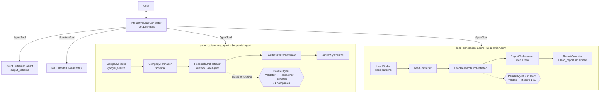

# (a) Deep-research lead generation agent

Emulates a market-research team: it **learns what successful market entrants did before they invested**
(pattern discovery) and then **finds companies showing those signals today** (lead generation).

## Architecture



* **State machine via callbacks** — `before_agent_run` seeds defaults; `after_tool_run` moves `stage`
  `initial → pattern_discovery → patterns_shown → report_ready`; `before_tool_guard` blocks lead generation
  until patterns exist (guardrail in code, not only in the prompt).
* **Dynamic fan-out** — the number of parallel pipelines is decided at run time from the companies found.
  Each branch has `include_contents="none"` so it only sees its own company (cheaper, no cross-talk).
* **Structured hand-offs** — every formatter/validator has a Pydantic `output_schema`.
* **State via `EventActions(state_delta=…)`** so it persists and flows back through `AgentTool`.

## Run

```bash
pip install -r ../requirements.txt
cp ../.env.example .env      # GOOGLE_API_KEY or Vertex AI settings
adk web                      # http://localhost:8000 → pick "lead_generation_agent"
# or: adk run lead_generation_agent
```

Demo conversation (≈ 3–5 min of real web research with k = m = 3):

1. `Find fintech leads in Thailand`
2. `Analyse 3 companies and find 3 leads`
3. *(patterns appear with sources)* → `Yes, find leads`
4. Open the **Artifacts** tab → `lead_report.md`

In the **Events / Trace** tab show the parallel `CompanyResearchPipeline_0..2` branches and the
state keys `validation_result_i`, `research_findings_i`, `discovered_patterns`, `final_lead_report`.

## Test & deploy

```bash
python -m pytest -q                       # offline, no API key needed
./deployment/deploy.sh agent-engine       # or: cloud-run
```
