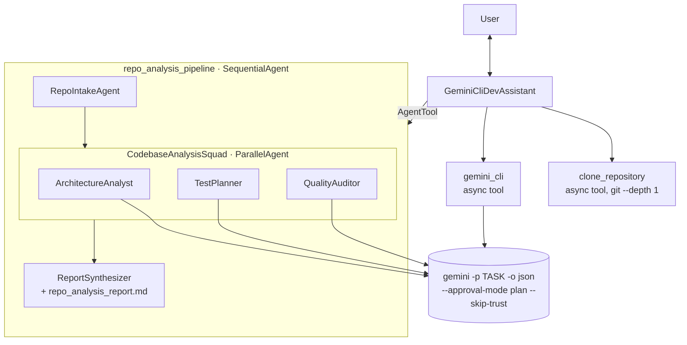

# (b) Advanced tool agent — Gemini CLI inside an ADK pipeline

The ADK agent plans and orchestrates; **Gemini CLI** (headless mode) does repository-scale work — it decides
which files to read, greps, follows imports — and returns JSON the agent consumes as a tool result.

## Architecture



| Hardening | Why |
|---|---|
| `asyncio.create_subprocess_exec` with an argument list (no `shell=True`) | a prompt or URL can't inject shell commands |
| GitHub URL allow-list regex | blocks `file://`, ssh, other hosts, `;`, `$()` |
| `--approval-mode plan` (read-only) by default | Gemini CLI can read but not edit files or run commands; opt in with `GEMINI_CLI_APPROVAL_MODE` |
| `-o json` parsing, structured errors, timeouts, output truncation | reliable tool results; protects the context window |
| async tools | the three `ParallelAgent` analysts really run concurrently (verified by test) |
| per-session call budget (`before_tool_callback`) | each CLI call is itself an agent run → cost control |

## Run

```bash
npm install -g @google/gemini-cli          # Node 20+
export GEMINI_API_KEY=...                  # or GOOGLE_GENAI_USE_VERTEXAI=true + GOOGLE_CLOUD_PROJECT/LOCATION
pip install -r ../requirements.txt && cp ../.env.example .env
adk web
```

Demo prompts:
1. `Give me a full analysis of https://github.com/google/adk-python` → pipeline, parallel analysts, report artifact
2. `In that repo, where is the LoopAgent implemented and how does it stop?` → single targeted `gemini_cli` call
3. `Draft unit tests for the URL parser in https://github.com/derrickchwong/gemini-cli-on-adk`

## Deploy to Cloud Run

```bash
gcloud artifacts repositories create adk-agents --repository-format=docker --location=us-central1
gcloud builds submit --config cloudbuild.yaml
# service account needs roles/aiplatform.user (Gemini CLI uses Vertex AI via ADC)
gcloud run services proxy gemini-cli-adk --region us-central1   # private service → local proxy
```
