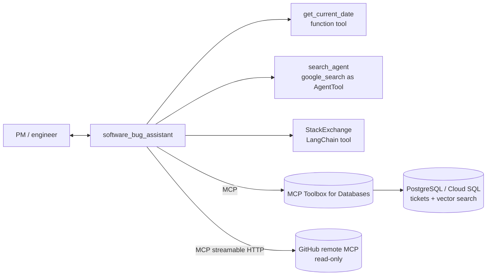

# (c) MCP-tools-based software bug assistant (QuantumRoast)

A triage assistant for a coffee-machine company that combines **five ADK tool types** in one agent.



* **MCP Toolbox** turns SQL in `mcp-toolbox/tools*.yaml` into 9 tools (search, get, create, update…),
  with connection pooling and auth handled by the server, not the agent.
* **Two toolsets**: `tickets_toolset` (full) and `tickets_readonly` (least privilege) — pick with `TOOLBOX_TOOLSET`.
* **GitHub MCP** is restricted twice: server-side headers (`X-MCP-Readonly`, `X-MCP-Toolsets`) and a client-side
  `tool_filter` predicate that only allows read verbs on issues/PRs/repos.
* Every external dependency degrades gracefully (agent still starts without Toolbox or a GitHub token).
* Local mode uses PostgreSQL full-text ranking; cloud mode uses `embedding('text-embedding-005', …)` inside Cloud SQL.

## Run locally

```bash
# 1. PostgreSQL (any local install, Docker, or Cloud SQL proxy)
psql -U postgres -f db/schema.sql && psql -U postgres -f db/seed.sql
# 2. MCP Toolbox for Databases (terminal 1)
npx @toolbox-sdk/server --config mcp-toolbox/tools.local.yaml --port 5000
#    (or the binary: toolbox --config mcp-toolbox/tools.local.yaml --port 5000)
# 3. Agent (terminal 2)
pip install -r ../requirements.txt && cp ../.env.example .env   # add GITHUB_PERSONAL_ACCESS_TOKEN (public-repo read only)
adk web
```

Demo prompts (in this order for the video):
1. `What tickets were opened in the last week?` → `get_current_date` + `get-tickets-by-date-range`
2. `Users say the login page freezes after 3 wrong passwords. Is there a ticket already?` → `search-tickets` (duplicate)
3. `We're seeing the XZ utils backdoor CVE. Find the GitHub issue and how it was patched.` → Google Search + GitHub MCP
4. `Python says "RuntimeError: Event loop is closed" in our uploader — any known fixes?` → StackExchange
5. `Create a P1 ticket: espresso machine QR-300 milk frother overheats after 30s, assign frank.white@example.com` → `create-new-ticket`
6. `Mark it In Progress` → `update-ticket-status`

## Test & deploy

```bash
python -m pytest -q -rs      # unit tests always; MCP integration tests when Toolbox runs on :5000
./deploy.sh database && ./deploy.sh toolbox && ./deploy.sh agent
```
