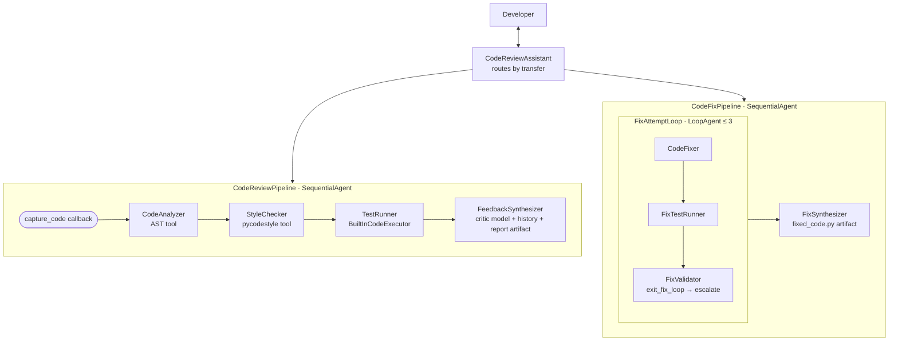

# (d) Production-quality code review assistant

Reviews Python code with **deterministic tools for anything measurable** (AST metrics, PEP 8, grades) and
**LLMs for judgement**, runs generated tests in a sandbox, and can **fix the code in a validated retry loop**.



| Production concern | How it's handled |
|---|---|
| Reliability | user code captured into state by a callback (LLM never re-types it); tools never raise; syntax errors reported |
| Correctness | grades/statuses computed in Python (`compute_grade`, `classify_fix`); `exit_fix_loop` refuses unless SUCCESSFUL |
| Cost | worker vs critic model split; `max_iterations`; `max_llm_calls` per request; input size limit |
| Safety | tests run in Gemini's sandboxed code executor, not on the server; code comments treated as data |
| Memory | `user:review_history` / `user:last_style_score` persist across sessions → "recurring issues" feedback |
| Ops | typed config (pydantic-settings, validated weights); Cloud SQL sessions, GCS artifacts, Cloud Trace (`main.py`) |
| Thread safety | pycodestyle results collected via a report object (reference redirected `sys.stdout` from a thread pool) |

## Run

```bash
pip install -r ../requirements.txt && cp ../.env.example .env
adk web                     # or: ./deploy.sh local  (FastAPI main.py on :8080)
```

Demo: paste this and ask for a review, then answer **yes** to the fix offer.

```python
def dfs_search_v1(graph, start, target):
    visited = set()
    stack = start
    while stack:
        current = stack.pop()
        if current == target:
            return True
        if current not in visited:
            visited.add(current)
            for neighbor in graph[current]:
                if neighbor not in visited:
                    stack.append(neighbor)
    return False
```

Show in the UI: state tab (`style_score`, `final_grade`, `fix_attempts`, `fix_status`), artifacts
(`code_review_*.md`, `fixed_code.py`), and the loop iterations in the trace.

## Test & deploy

```bash
python -m pytest -q
./deploy.sh cloud-run       # Cloud SQL sessions + GCS artifacts + Secret Manager password
./deploy.sh agent-engine    # managed alternative
```
